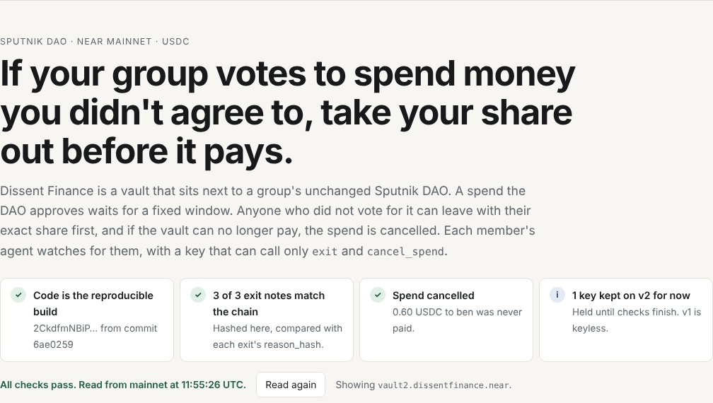
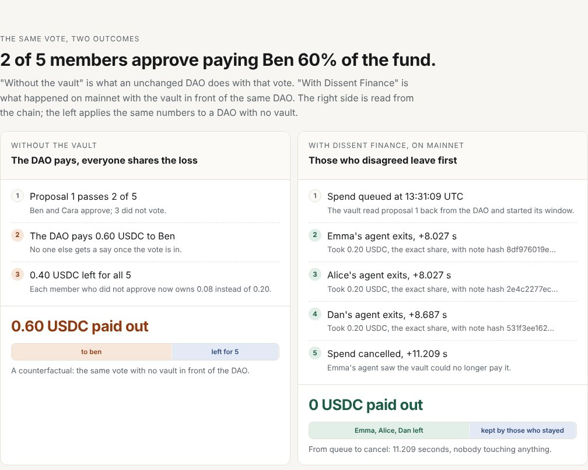
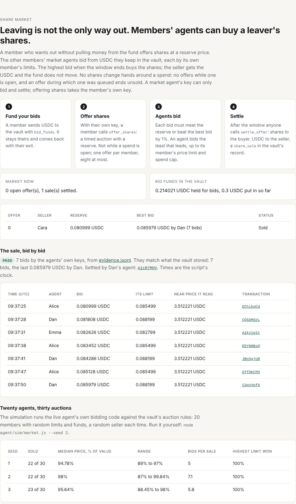

# Dissent Finance

[](https://github.com/QijomoFav35/Dissent-Finance/actions/workflows/ci.yml) [](https://github.com/QijomoFav35/Dissent-Finance/actions/workflows/watch.yml) [](https://github.com/QijomoFav35/Dissent-Finance/actions/workflows/guard.yml)

**When a Sputnik DAO votes to spend the group's money, members who did not approve can take their share out before it pays, and their agents do it for them.**

Live on NEAR mainnet with real USDC, next to an unchanged Sputnik DAO whose factory auto-update is turned off. In 16 Sputnik DAOs, 473 approved transfers went through over at least one Reject vote ([427 of them routine payouts in one DAO](docs/REPLAY.md)); none of those members had a way out. Check every claim here in under a minute, with no wallet: `node agent/mainnet/verify.mjs`.

[Live page](https://qijomofav35.github.io/Dissent-Finance/) (reads mainnet in your browser) · [JUDGE.md](JUDGE.md) (five-minute path) · [Every mainnet transaction](docs/MAINNET.md) · Social Money track · Not audited

## What happened on mainnet

- **The vote that didn't pay.** Ben and Cara, two of five members, approved 60% of the fund to Ben. Alice's, Dan's and Emma's agents each found the spend broke one of their member's rules, wrote a note, and left with their exact share. Emma's agent then cancelled the spend, which the vault could no longer pay: 11.2 seconds from queue to cancel by the vault's own timestamps, nobody touching anything, Ben paid nothing ([queue](https://nearblocks.io/txns/DpKwEZ8L419yKGqnxDrqrv5hQK4UJM7pYCVtEMbAYxwu), [cancel](https://nearblocks.io/txns/4cA4kFtvvuz6bVb5FRjP35Q76sHQKq3hWsabd59xLAAT)). It ran first on v1, which has no access keys.
- **Selling instead of leaving.** Three members' agents, on keys that can only bid and settle, bid 7 times for part of Cara's shares, priced from Ref Finance's NEAR/USDC pool. Dan bought at 95.5% of value; the fund did not move ([offer](https://nearblocks.io/txns/6DxKZ99sg7t84ieVKXA7z9hmvcoPrzpSjjPKrAJvFwFN)).
- **An approver who leaves still pays her part.** Cara approved a spend and left while it was open. The vault held back her 23.9% of it, and when the spend paid, that part paid her share ([exit](https://nearblocks.io/txns/53qLDWKV7hAij7P9MeJFRjshBJfeKR8GRaTpsd4ikd6u), [spend](https://nearblocks.io/txns/9osUXBVnfdFhMyzKT4xKVKkzFJ56pnwAqoVdRj5kteKX)).
- **The DAO locked.** Members voted the DAO's factory auto-update off, so only a council proposal can change the DAO's code ([proposal 2](https://nearblocks.io/txns/C3qanhdzVAaQy2NQVXpmTE1aZ9KCPsoJZtj8rvcr87M4)).

| The live page's own checks | The same vote, two outcomes | The share sale, bid by bid |
|---|---|---|
| [](https://qijomofav35.github.io/Dissent-Finance/) | [](https://qijomofav35.github.io/Dissent-Finance/#outcomes) | [](https://qijomofav35.github.io/Dissent-Finance/#market) |

The DAO is a stock one from the `sputnik-dao.near` factory, and [Trezu](https://trezu.app/dissentfinance.sputnik-dao.near/requests?tab=Approved) shows it like any treasury.

## Why this, and what is new

Moloch DAO's "ragequit" (2019) lets members who did not vote Yes leave with their share during a grace period before a proposal runs. Sputnik DAO, which most NEAR groups use, has nothing like it, and moving a treasury to a new DAO is a big ask. Dissent Finance adds it next to an unchanged Sputnik DAO: the DAO keeps its members, roles and votes, and only the money moves into the vault. Three things are new:

1. **Agents leave for you.** Each member sets three rules (the largest share of the fund one spend may take, whether the receiver must have been paid before, blocked receivers). Their agent checks every approved spend, writes a note, and exits with the note's hash, on a key that can only call `exit` and `cancel_spend`. Nobody has to be awake.
2. **Approvers can leave too, without dodging the bill.** In Moloch a Yes voter cannot ragequit until the proposal is processed. Here they can leave at once; their part of each spend they approved stays behind and pays for it.
3. **A price for leaving.** A member can sell shares to other members' agents in a timed auction instead of pulling money out of the fund ([RULES.md](RULES.md)).

## How it works, in short

- A spend is an ordinary DAO proposal: a `FunctionCall` to the vault's `queue_spend`. When it passes, the vault reads the proposal back from the DAO, checks its arguments byte for byte, records who approved, and starts a fixed window.
- During the window members who did not approve can `exit` with their exact pro-rata NEAR and USDC, nobody can join, and an approver who leaves has their part held back.
- After the window `execute_spend` pays the receiver plus a 0.1% fee, if the vault can still afford it; if not, anyone can `cancel_spend`.
- Agents read only public views, never the proposal's description, and their rules are stored on chain, so anyone can replay a decision from its note. There is no model in the exit path.

The full design, storage limits and agent behaviour are in [docs/HOW-IT-WORKS.md](docs/HOW-IT-WORKS.md). To add it to a DAO you already run, see [docs/ADOPT.md](docs/ADOPT.md).

## The story the tests check

Five friends put 10 NEAR and 100 USDC each into a vault. At 3am Ben and Cara, two of the five, approve 300 of the 500 USDC to Ben. Alice's rule says leave if one spend takes more than 20% of the fund. Dan's says leave if the receiver has never been paid before. Emma has blocked Ben as a receiver. Their three agents see the spend, write a note saying which rule broke, and exit with exactly 100 USDC each. That leaves 200 USDC, so the spend can't be paid and gets cancelled. In the sandbox test, five separate agent processes, each holding only its own member's key, finish this about one second after the vote.

## Check it yourself

```sh
git clone https://github.com/QijomoFav35/Dissent-Finance && cd Dissent-Finance
node agent/mainnet/verify.mjs               # v2: 22 checks, read-only, Node 20+, no installs
node agent/mainnet/verify.mjs --vault vault # v1
near contract verify deployed-at vault2.dissentfinance.near network-config mainnet now   # rebuilds the deployed code (Docker)
```

`verify.mjs` reads one final block and checks the vault's code hash against the reproducible build, its access keys, that the DAO runs the factory's unmodified code with auto-update off, that every agent key can call only its two methods, every exit's hash against its published note, the share sale against its reserve, and that the books balance against the USDC contract's own balance. It runs every hour in the `Mainnet verify` workflow.

## Tests

| Suite | Command | What it covers |
|---|---|---|
| 82 contract tests, 2 of them property tests | `cd contracts/vault && cargo test --lib` | random sequences of joins, spends, votes, exits, claims and market moves; books, shares, holds and bid funds checked after every step |
| 10 sandbox tests | `cargo test --test sputnik_flow` | the real mainnet Sputnik DAO code, real proposals and votes, agent and market keys refused outside their methods |
| 5 agent processes | `cargo test --test swarm_scenario -- --nocapture` | the story above with one process per member key |
| 53 agent tests | `cd agent && npm install && npm test` | decisions, retries, notes, prompt injection in a memo, the market agent, and `verify.mjs` against six planted faults |
| 9 page tests | `cd tests/page && npm install && npx playwright install chromium && npm test` | the live page in headless Chromium |

Expected output for each, step by step: [docs/TESTING.md](docs/TESTING.md). CI runs all of them on every push.

## Known limits

- The vault is a separate contract next to the DAO, so the DAO's own rules still decide what passes. The vault decides only whether a passed spend can be paid, and when.
- Members' exits are protected, but the vault's spare storage is not. Outsiders with 0.1 USDC each can fill it with pending deposits: each takes roughly 150 bytes, so about a hundred of them fill the mainnet vault's spare room. The USDC stays theirs and comes back with `cancel_join`. Exits, cancels and claims keep working; new joins, rule changes and spends are refused until someone sends the vault a little NEAR, which anyone can do.
- The reserve grows with the number of members, about 1 KB each. The mainnet vault was funded with 0.25 NEAR above its code's storage, enough for a small group; a larger group needs someone to send it more NEAR first.
- At most 8 spends can be open at once. A majority that keeps 8 slots full can stop new spends and joins; if they leave, they still pay their part of each of those spends they approved.
- If a spend's payment bounces and the receiver later claims it, the receiver is still counted as never paid, which only matters for the "new receiver" rule.
- The spend window is set when a vault is created and can't change once its key is deleted. The mainnet vaults use 10 minutes so a full cycle can be watched; a real group would choose hours or days.
- NEAR or USDC sent to the vault in any way other than `ft_transfer_call` with msg "join" plus `join` is not credited to anyone and can't be recovered.
- The vault reads the DAO's `get_policy` and `get_proposal`. A future Sputnik upgrade that changed their shape would stop new joins and spends; exits don't read the DAO and would keep working.
- Money held back from an approver who left comes back only through `claim`, which needs a key that can call it (the member's full key; agent keys call only `exit` and `cancel_spend`).
- The NEAR price is a DEX spot price, and it trusts Ref Finance's contract, which Ref's own governance can upgrade. Someone willing to trade against a pool of about 1.9 million dollars could move it for a block; for the sums in these auctions that costs far more than it could gain, but a large auction would want a time-weighted price. The reserve protects the seller from a low bid, not from a reserve they set too low.
- Any spend queued while an auction runs ends that auction unsold, even a spend that settles before the auction ends. This protects bidders, and it means a council that queues spends often leaves little room for sales.
- A bidder who exits while leading an auction takes their bid back, and the auction carries on with no bids; earlier, outbid bids are not restored, so a late exit by the leader can leave an offer unsold.
- The agent runs on the member's own machine or server. If it is offline for the whole window, the member can still exit by hand.

## Agents on duty

`.github/workflows/guard.yml` keeps agents watching `vault2.dissentfinance.near` around the clock, in shifts of just under six hours. Each runs in its own process with only its own member's function-call key, and `agent/mainnet/guard.mjs` reads every key from chain first and refuses any that can do more than `exit` and `cancel_spend`. The page's Proof section shows whether a shift is running now.

## Where things are

| | |
|---|---|
| [docs/HOW-IT-WORKS.md](docs/HOW-IT-WORKS.md) | the full design: windows, holds, storage, agents, keys |
| [RULES.md](RULES.md) | the share market's rules and the market agents' strategy |
| [docs/MAINNET.md](docs/MAINNET.md) | every mainnet run and transaction, v1 and v2, and the reviews before each |
| [docs/ADOPT.md](docs/ADOPT.md) | adding Dissent Finance to a DAO you already run; costs and the fee |
| [docs/TESTING.md](docs/TESTING.md) | every test with what you should see |
| [docs/REPLAY.md](docs/REPLAY.md) | 30 rule profiles run over 473 real contested Sputnik DAO spends |

## Layout

```
contracts/vault       the vault contract, unit tests, property tests, sandbox tests
contracts/test-usdc   a NEP-141 token with open mint, for tests only
agent/src             the exit agent and the market agent: rules, notes, reader, limited-key signer, watcher
agent/sim             the swarm replay and the share market simulation
agent/mainnet         the mainnet scripts, evidence.jsonl, published notes, verify.mjs, guard.mjs
tests/page            headless tests of the demo page
docs                  the live page (GitHub Pages), and the longer docs listed above
.github/workflows     ci.yml (every test), watch.yml (hourly mainnet checks), guard.yml (agents on duty)
scripts               fetch-sputnik.mjs, replay3.mjs
replay3.json          the replay data used by the simulation
```

To run a watcher for one member: copy `agent/agent.config.example.json`, set the vault and RPC, put the member's function-call key in the environment variable named in the config, and run `node agent/src/watch.js agent.config.json --member <account>`. One process holds one member's key.
